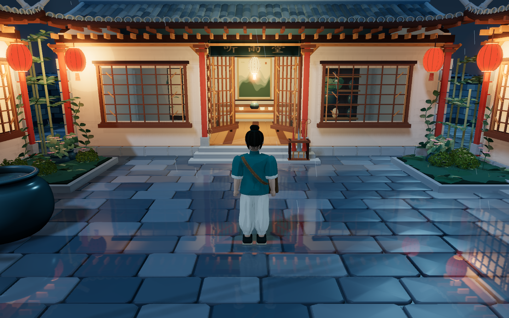

# 听雨小镇 · 天光与风雨

版本 **0.3.0**。第三人称中式街区漫游游戏，保留紧凑雨夜画风，并加入清晨、白天、夕阳、夜晚与四种天气的自由组合。天空、光照、灯火、雨丝、地面湿度、倒影和环境声随选择一起变化。



## 开始游玩

**双击根目录的 `启动听雨小镇.cmd`。** 游玩期间保留启动窗口，结束时关闭窗口或按 Ctrl+C。

```powershell
python scripts/play.py
```

入口为 `http://127.0.0.1:8001/`。已构建的版本无需 Node.js 或联网下载游戏资源；启动服务需要 Python 3，浏览器需要支持 WebGL 2。

可分发游玩包：`release/tingyu-town-v0.3.0.zip`。完整操作说明见 [README-游玩说明.md](README-游玩说明.md)。

## 雨夜街区

整张地图由约 180×180 米收拢为 **56×56 米的完整方形街区底座**。10 栋建筑围合小院、青石雨巷、茶铺、水街和柳岸，石桥与木桥连接两岸；完整环线和两条巷角支路均可双向行走。听雨堂、两间茶铺与竹里书屋可以进入。

沿路可见青砖黛瓦、月洞门、通透木格窗、红灯笼、太师椅与茶具、博古架、屏风、竹丛、芭蕉形叶簇、盆栽、水缸、雨棚、雨链、自行车、邮筒、公告栏、雨伞架、竹编篮、排水沟、街灯、电线杆与电线。屋顶遮挡雨丝，地面与河道分别呈现随视角变化的倒影。

| 操作 | 功能 |
| --- | --- |
| WASD / 方向键 | 行走 |
| Shift | 轻跑 |
| 鼠标拖动 / 滚轮 | 观察 / 缩放镜头 |
| H | 隐藏或显示游戏界面 |
| M | 街区地图与到访记录 |
| P | 拍照并保存无界面的 PNG |
| T / 右上角“景” | 天气、时辰与自动昼夜流转 |
| Esc | 暂停、帮助与三档画质 |
| R | 回到听雨小院 |
| 右上角“声” | 开关合成雨声与檐下滴水声 |

## 天气与时间

按 **T** 或点击右上角“景”打开“天光与风雨”。暂停菜单和拍照模式中也有入口，打开面板时可以直接预览变化。

- 时辰：清晨（06:00）、白天（12:00）、夕阳（18:00）、夜晚（22:00）。
- 天气：晴朗、多云、细雨、大雨，可与任意时辰组合。
- 可选自动昼夜流转，漫游或拍照时约 8 分钟一昼夜；打开地图、暂停、天气面板或离开页面时停止推进。
- 手动选择时辰会关闭自动流转。雨停后地面逐渐收干，雨声随雨量淡出；白天街灯减弱，室内仍保留柔和照明。
- 时间和天气设置保存在当前浏览器中。默认是细雨夜晚，环境声音仍需手动开启。

## 开发与验证

使用 Node.js 24、npm 11 和 Python 3；依赖版本由 `package-lock.json` 锁定。

```powershell
npm.cmd ci --ignore-scripts
npm.cmd run dev
npm.cmd run verify
npm.cmd test
```

开发入口为 `http://127.0.0.1:5173/`，生产输出为 `dist/game/`。`verify` 检查初版文件与原型校验值、库加载、类型和生产构建。`test` 检查第三人称操作、完整路线、碰撞、台阶、镜头、地图和拍照。

- `npm.cmd run test:climate`：16 种天气/时辰组合、画面差异、雨声、自动时钟、暂停、拍照、持久化及重复切换检查。
- `npm.cmd run test:art`：八组机位、三档画质、镜头转向与窗口缩放的画面回归。
- `npm.cmd run test:production`：游玩服务启动后检查 Chrome 与 Edge；可用 `TINGYU_PLAY_URL` 指定其他本地端口。
- `npm.cmd run test:stability`：10 分钟跨区域运行稳定性检查。
- `npm.cmd run package`：构建并生成独立游玩包；`npm.cmd run test:package` 校验包内文件、解压运行和 gzip，更新 `release/SHA256SUMS`。

画面测试与稳定性测试共用端口 5176，需依次执行。原始报告和额外截图位于被 Git 忽略的 `test-results/`。

当前功能和验证见 [天气与时间交付记录](docs/delivery-v0.3.0.md)。雨夜画风重整见 [0.2.0 记录](docs/delivery-v0.2.0.md)。[0.1.0 记录](docs/delivery-v0.1.0.md) 与 [前期设计资料](docs/preproduction/README.md) 保留为历史资料。

## 原版雨夜小院

初版 `index.html`、`src/`、`vendor/` 和 `assets/preview.png` 保持原内容。直接打开根目录 `index.html` 或运行 `python scripts/serve.py` 可查看初版无人物的微缩观景；新版第三人称游戏通过启动器打开。原版说明见 [legacy-courtyard.md](docs/legacy-courtyard.md)。

运行时的模型、材质、图案与环境声在代码中生成。第三方库许可证见 `licenses/` 和 [THIRD_PARTY_NOTICES.md](THIRD_PARTY_NOTICES.md)。
