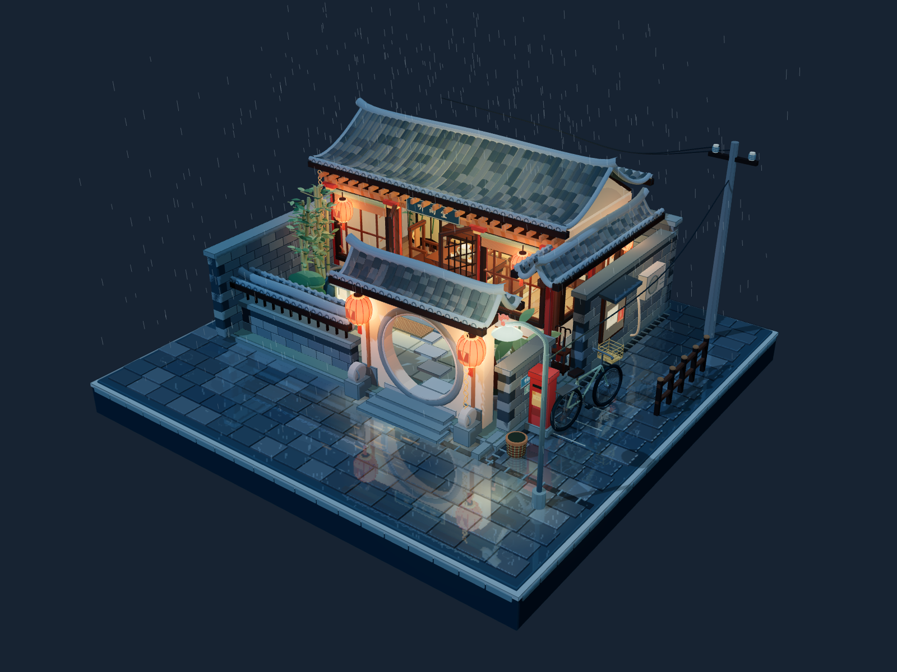

# 听雨小院

基于 Three.js 的雨夜中式庭院微缩景观。完整方形底座、月洞院门、青砖瓦顶、木格玻璃窗与茶室陈设，搭配暖红灯笼、动态雨丝、涟漪和地面倒影。画面不含操作面板。



## 打开与操作

桌面浏览器可直接打开根目录 `index.html`，无需安装 Blender、Node.js 或联网下载依赖。

- 鼠标左键拖拽 / 手机单指拖拽：旋转。
- 鼠标滚轮 / 手机双指捏合：缩放。
- 鼠标右键拖拽：平移。
- 双击：恢复初始视角。

iPhone 建议通过 Safari 访问已部署的网页；“文件”App 的本地 HTML 预览不能保证运行 WebGL 和 JavaScript。较旧手机的流畅度可能受实时反射、阴影和像素密度影响。

## 项目结构

```text
index.html                 可直接运行、可部署的单文件页面（构建产物，已提交）
src/
  courtyard.js             场景基础、建筑和室内
  courtyard-detail.js      院门、植物、陈设、雨景、反射与交互
  template.html            页面模板
vendor/three/
  three.min.js             固定版本的 Three.js 0.160.1 / r160
  Reflector.js             上游平面反射实现
  LICENSE                  Three.js MIT 许可证
scripts/
  build.py                 构建；仅使用 Python 标准库
  serve.py                 本地预览服务器
assets/preview.png         场景预览图
archive/                   原始制作文件与检查截图
THIRD_PARTY_NOTICES.md     第三方来源与修改说明
```

`courtyard.js` 与 `courtyard-detail.js` 按顺序合并成一个作用域，两者不是独立 ES 模块。模型、材质、纹理和动画均在代码内生成，无额外模型或贴图文件。`index.html` 内嵌所有运行代码，不依赖 CDN。

## 修改与构建

仅重新构建时需要 Python 3（无需 pip 安装任何包）：

```powershell
python scripts/build.py
python scripts/build.py --check
```

若 Windows 使用 Python Launcher，也可将 `python` 换成 `py -3`。

从任何工作目录运行构建脚本都可以，脚本使用自身路径寻找项目文件。请修改 `src/`，再构建生成 `index.html`。构建时对上游 Reflector 的导入、导出和湿路面混合方式进行适配，原始依赖文件保留不变。

## 本地预览

```powershell
python scripts/serve.py
```

浏览器访问 `http://127.0.0.1:8000/`。按 Ctrl+C 停止。服务器只提供页面和预览图，不列出源码或历史文件。

需要同一局域网内访问时，可以指定 `--host 0.0.0.0`；这只用于本地预览，与部署到互联网是两回事。

## 提交 Git 与部署

当前页面已命名为 `index.html`，可将项目作为静态站点部署。托管方若要求构建命令，使用 `python scripts/build.py`；若直接发布已有静态文件，则无须构建。入口为根目录 `index.html`。

进入本地 Git 仓库后，可检查并提交：

```powershell
git status
git add .
git commit -m "Initial Tingyu courtyard scene"
```

随后为自己的仓库配置 remote 并推送。项目不包含远程仓库地址、账户或凭据。第三方代码的许可证位于 `vendor/three/LICENSE`；项目没有替作者额外指定原创部分的开源许可证。

## 历史文件

`archive/original-work/` 和 `archive/original-outputs/` 保留本次整理时的全部原始工作文件、旧版失败稿、渲染检查截图与旧构建脚本，便于追溯。它们不参与当前构建。旧脚本中可能保留原工作区路径；当前 `src/` 与 `scripts/` 不依赖原工作区。旧手机二维码只对应当时电脑的局域网入口，不可用作部署地址。
