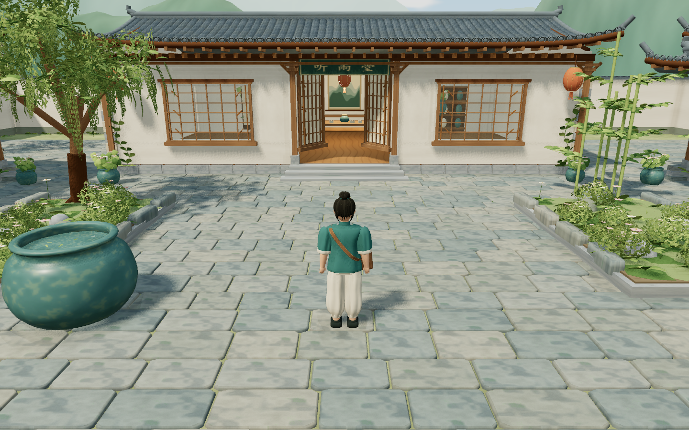

# 听雨小镇

一款可以在电脑浏览器中游玩的第三人称江南小镇漫游游戏，版本 **0.1.0**。以原版听雨小院为起点，按 `yuanxingtu/` 中的五张原型扩展为春日雨后的两岸小镇。

2026-10-21 画面更新：细化人物衣褶与配件、青瓦飞檐、湿润青石、花草与陶器，完善天空、远山、接触阴影和水面倒影。详见 [本轮优化记录](docs/art-refinement-2026-10-21.md)。



## 开始游玩

**双击根目录的 `启动听雨小镇.cmd`。** 启动器会提供本地网页并打开浏览器。游玩期间保留启动窗口，结束时关闭窗口或按 Ctrl+C。

```powershell
python scripts/play.py
```

入口为 `http://127.0.0.1:8001/`。本机已具备 Python 3 与 Chrome/Edge；运行已构建的版本不需要安装 Node、游戏编辑器或联网下载资源。

完整说明见 [README-游玩说明.md](README-游玩说明.md)。可分发压缩包位于 `release/tingyu-town-v0.1.0.zip`，解压后也可双击其中的启动器。

## 玩法

| 操作 | 功能 |
| --- | --- |
| WASD / 方向键 | 行走 |
| Shift | 按住轻跑 |
| 鼠标拖动 / 滚轮 | 观察四周 / 缩放镜头 |
| M | 小镇地图与到访记录 |
| P | 拍照模式和 PNG 保存 |
| Esc | 暂停、帮助、三档画质 |
| R | 回到听雨小院 |
| 右上角“声” | 开关合成环境声 |

从小院出发，经青石巷、榕荫小集和望溪石桥进入东岸竹里，再通过归云木桥与柳岸返回。环线和两条观景支路都可双向行走。小院茶室与两间茶铺可进入，其他民居以室外观赏为主。

当前版本包含 17 栋建筑、两座桥、两处亭、程序化旅人及步行动画、碰撞与镜头避障、水纹/反射、风动植被、落花、七处到访地点、地图、拍照和暂停系统。首版面向电脑键鼠，暂未包含手机摇杆、NPC 任务、战斗或存档。程序化模型保留原型的元素与配色，细节比概念图简化。

## 开发与验证

本机使用 Node.js 24.18.0、npm 11.16.0、Python 3.13.14。依赖版本由 `package-lock.json` 锁定。

```powershell
npm.cmd ci --ignore-scripts
npm.cmd run dev
npm.cmd run verify
npm.cmd test
```

开发入口：`http://127.0.0.1:5173/`。生产输出：`dist/game/`。

`verify` 检查原版构建、原型及历史文件校验值、库加载、TypeScript 类型与生产构建。`test` 使用本机 Chromium 浏览器执行真实键鼠、完整路线、碰撞、镜头和功能检查。

已启动本地游玩服务器后，可运行 `npm.cmd run test:production` 检查 Chrome/Edge 生产版本。`npm.cmd run test:stability` 执行 10 分钟运行稳定性测试。原始报告与截图生成到被 Git 忽略的 `test-results/`。

`npm.cmd run test:art` 生成七组固定机位与画质/窗口回归截图，检查天空亮度和浏览器运行错误。它与稳定性测试共用端口 5176，需依次执行。

运行 `npm.cmd run package` 生成游玩包后，`npm.cmd run test:package` 检查 ZIP 文件与工作区逐字节一致、解压后的服务器与 JS gzip，并更新 `release/SHA256SUMS`。

```powershell
npm.cmd run build
python scripts/package-game.py
```

构建中较大的 JavaScript 包主要来自 Rapier 内嵌的 WebAssembly；本地游玩服务器对页面、JS 和 CSS 提供 gzip。部署互联网时，只需发布 `dist/game/` 的静态内容并开启托管方的压缩。

## 代码和文档

- `game/src/`：新游戏运行时代码；渲染、世界、构件、材质、物理、角色、相机、音频与界面。
- `scripts/play.py`：生产构建本地服务器；`scripts/package-game.py`：独立游玩包。
- [开发准备](docs/preproduction/README.md)：原型解读、地图、资产、技术计划和环境记录。
- [交付与验证](docs/delivery-v0.1.0.md)：实际完成范围、测试证据和限制。
- `licenses/` 与 [第三方说明](THIRD_PARTY_NOTICES.md)：新游戏运行库许可证。

## 原版雨夜小院

根目录 `index.html`、`src/`、`vendor/` 与 Python 构建流程保持为原版微缩景观。它仍可直接离线打开；`python scripts/serve.py` 在端口 8000 提供旧版预览。新游戏与旧版分别使用 Three.js r186 / r160，不在同一页面混载。

原版说明保存在 [legacy-courtyard.md](docs/legacy-courtyard.md)，原始制作资料位于 `archive/`。
