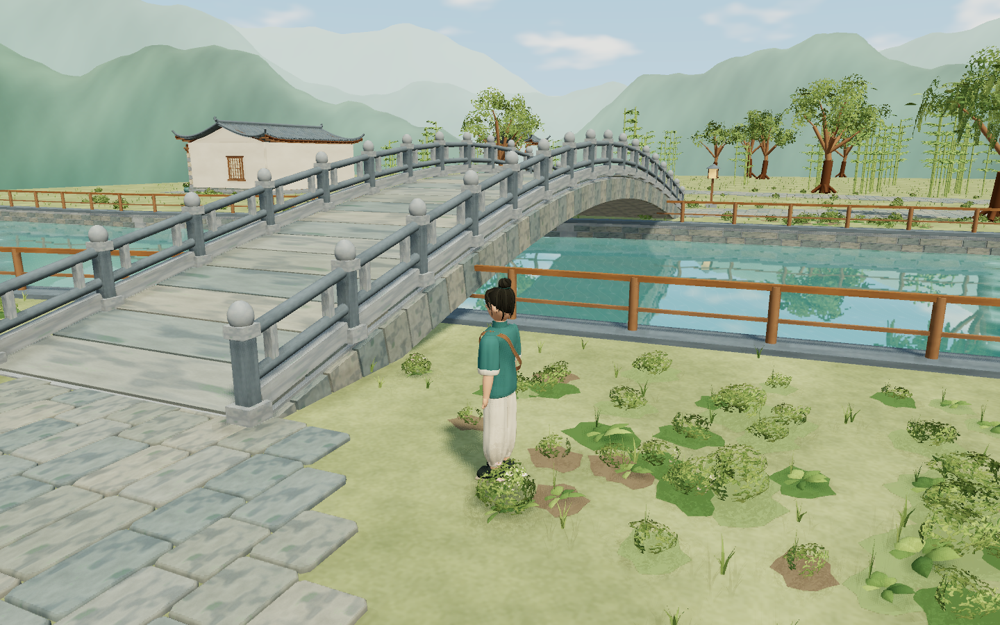

# 听雨小镇 · 画面优化记录

更新日期：2026-10-21（Asia/Shanghai）。本轮针对 `yuanxingtu/` 中春日雨后江南的原型，改善人物轮廓、建筑细节、石板与植被材质、天空和水面层次。

## 已完成

- 人物：连续的衣裤曲面与褶皱、领口和盘扣、袖口与束脚、布鞋、分束头发、五官、手部和带搭扣的斜挎包；保留现有待机与步行动画。
- 建筑：弧面瓦片、瓦当、屋脊与飞檐、檐下构件、窗格、门扇、灯笼及更完整的茶室陈设。
- 地面与器物：错缝青石铺装、磨损倒角、湿润色差和苔痕；木纹、墙面与陶釉的颜色、法线和粗糙度细节；水缸、花盆和茶具的口沿与内部厚度。
- 植被：弯曲叶簇、柳枝、竹叶、花坛底层、藤蔓、花朵和桥头岸边的成簇花草；装饰避让道路、铺装与桥口。
- 环境：有内部明暗变化的连续远山、程序云、暖日光、近景接触阴影和水面平面倒影。低画质使用环境反射；均衡与细致画质增加随视角更新的倒影。
- 渲染修复：天空与水面统一输出颜色处理；三档画质切换时天空亮度保持一致。倒影纹理边缘渐变回环境反射，镜头转向和窗口缩放后更新投影。
- 重复构件：按区域实例化；花心与瓦当等小尺寸球体使用较低细分，减少细节模型的几何开销。

## 验证与交付

`npm.cmd run verify` 与 `npm.cmd test` 已通过。功能测试包含 19 项检查，覆盖真实键鼠、暂停与失焦、完整双向环线与两条支路、碰撞、台阶、镜头避障、地图和照片保存。

画面复查覆盖小院、人物正面、广场、河岸、石桥、竹里和茶室，并检查低/均衡/细致画质、两种窗口尺寸与镜头转向。三档画质的固定天空采样亮度约为 0.7846，最大差值小于 0.0002；未记录浏览器运行错误。

完整生产、稳定性与分发包结果见 [交付记录](delivery-v0.1.0.md) 和 [机器可读验证报告](verification-v0.1.0.json)。原始报告和额外截图位于 `test-results/`。

## 实际范围

本轮仍采用代码生成的风格化三维模型。原型中的高密度建筑、植被与电影感材质仍更复杂，当前实机画面没有达到概念图的全部细节。新增几何、材质和倒影也提高了显卡负担：本机 GT 730 在 1440×900、像素比 1、均衡画质的广场静止视角约为 31 FPS；设备较慢时可在暂停菜单切换“轻盈”。

原版雨夜小院和五张原型图的内容校验保持通过。当前生产构建与分发包由同一份优化后的源码生成。
