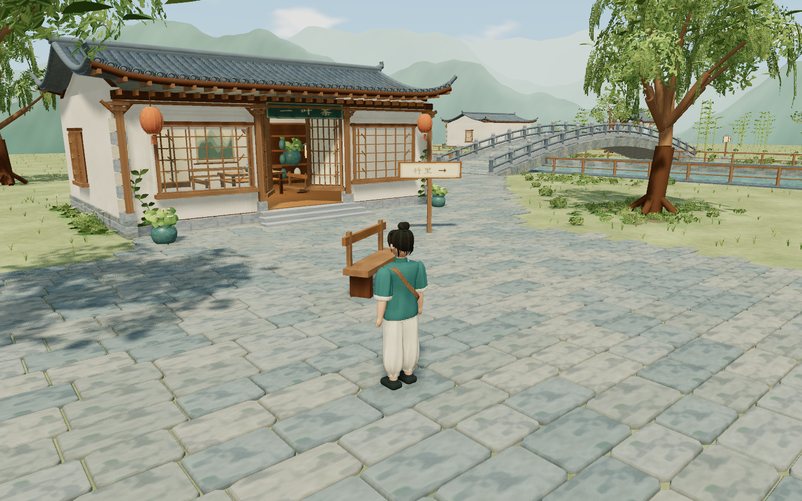

# 听雨小镇 v0.1.0 · 交付记录

更新日期：2026-10-21（Asia/Shanghai）。本轮已在可行走、可观景的第三人称小镇基础上细化人物、建筑、植被与材质，并完善天空、远山、接触阴影和水面倒影。具体改动见 [画面优化记录](art-refinement-2026-10-21.md)。

## 直接打开

双击根目录 [启动听雨小镇.cmd](../启动听雨小镇.cmd)，或运行 `python scripts/play.py`。浏览器入口是 `http://127.0.0.1:8001/`。现有构建已经生成，直接游玩不需要 npm 安装或构建。

分发文件：[tingyu-town-v0.1.0.zip](../release/tingyu-town-v0.1.0.zip)。大小 1,846,441 字节，包含 9 个文件；解压后双击其中的启动器。游玩说明随包提供。本地启动依赖 Python 3 和支持 WebGL 2 的浏览器。

ZIP SHA-256：`da01b6dd300170f1058403f5abe4241a1c0f87ba56f9e342a993f624469a8f86`。

## 实际完成

| 范围 | 成果 |
| --- | --- |
| 世界 | 约 180×180 米的连续可游览区域，17 栋建筑、北石桥、南木桥、两处亭、河道、院落、花园与竹林 |
| 路线 | 小院连接完整两岸环线，含东北小亭、西南花园两条观景支路；均可双向行走 |
| 人物 | 青绿中式短衫、米白裤、布鞋、发髻与斜挎包；关节驱动的待机和步行动画 |
| 运动 | 相机相对 WASD/方向键、轻跑、斜向归一化、台阶与坡面；Rapier 胶囊和独立场景碰撞 |
| 相机 | 第三人称跟随、鼠标拖拽、滚轮、体积检测避障、近距离隐去人物 |
| 环境 | 春日太阳/云层/薄雾、分层远山、水面波纹与平面倒影、近景接触阴影、风动叶片、落花、蝴蝶、茶室暖光 |
| 生活空间 | 可进入的听雨堂与两间茶铺，桌椅、茶具、书架、屏风、水缸和盆栽 |
| 界面 | 实时位置、方向、七处到访记录、小地图/大地图、暂停/帮助、三档画质、回院复位 |
| 体验 | 无界面 PNG 拍照保存、可选的合成风/水/鸟鸣、失焦与页面隐藏时暂停 |
| 交付 | 独立生产构建、本地启动器、gzip、本地分发 ZIP、游玩说明与源码 |

建筑、角色、植被遮罩、纹理、水材质、文字牌与环境声均由项目代码生成；运行时不下载模型、贴图、字体或音频。没有使用平面原型图充当可行走场景。

## 验证证据

可追溯的机器可读汇总：[verification-v0.1.0.json](verification-v0.1.0.json)。每次重新运行测试的完整原始报告会写到 `test-results/`，该目录被 Git 忽略。

| 检查 | 实际结果 |
| --- | --- |
| `npm.cmd run verify` | 原版构建一致、5 张原型与 8 个旧文件校验一致；Three/GLTFLoader/Rapier 可加载；TypeScript 和生产构建通过 |
| `npm.cmd test` | 19 项断言通过：真实键鼠、失焦/暂停/复位、地图/拍照、完整双向环线、两支路、墙/河岸/桥栏/边界/桌子、茶室台阶、镜头避障与斜向速度 |
| Chrome 生产版本 | 155.0.8059.80，真实走出小院到青石巷、地图、音频、拍照、三档画质、复位与窗口缩放通过 |
| Edge 生产版本 | 155.0.4283.62，同一组生产检查通过 |
| 运行请求 | 生产检查没有外部请求、404、运行时错误或 shader 错误；生产页面不暴露开发诊断对象 |
| 10 分钟运行 | 600.007 秒，跨七种视角循环，无运行错误；预热后几何体与纹理增长均为 0 |
| 分发包 | 9 个文件逐字节对应工作区；解压后的启动器服务器可提供游戏，JS gzip 正常 |
| 画面回归 | 七组固定机位、三档画质、窗口缩放与镜头转向检查；天空亮度最大差值小于 0.0002，无浏览器运行错误 |

性能采样条件：Windows 10、本机 NVIDIA GeForce GT 730（ANGLE D3D11），Chrome 155，1440×900、像素比 1、均衡画质，C 广场静止视角采样 240 帧。2026-10-21 优化后平均帧时间约 32.09 ms（约 31 FPS），P95 约 49.9 ms；采样帧记录 433 次绘制调用、1,812,953 个三角形（包含该帧发生的渲染通道）。新增细节和倒影提高了显卡负担，较慢设备可使用“轻盈”画质。此数据代表这一台机器和固定视角，不承诺所有设备、分辨率与移动路线都达到同一帧率。

静态建筑的阴影在需要时更新，人物使用柔和接触阴影；植被、瓦片与重复构件按区域实例化，控制重复提交。轻盈画质关闭屏幕接触阴影与平面倒影，保留环境反射。大型 JS 块主要来自兼容版 Rapier 内嵌 WASM；构建成功，本地服务器已启用 gzip。

## 实机画面

其他机位：[标题](../assets/game-title.png)、[桥面](../assets/game-bridge.png)、[竹里](../assets/game-bamboo.png)。这些图片来自实际游戏渲染。

## 当前边界与后续空间

这是完成首期目标的可游玩版本。画面采用程序化风格化 3D，保留原型的色彩、空间元素和服装识别点；人物、植物和建筑材质的细腻程度仍比原型图简化。后续美术迭代可以替换更精细的角色/建筑 GLB、贴图与动作，而保留当前运动与世界系统。

主要支持电脑键鼠；手机虚拟摇杆、NPC、任务、战斗、存档、游泳与远山探索不在这次实现范围。河道受栏杆和岸边碰撞限制，非茶铺民居主要供外部观赏。到访记录是本次会话状态，刷新后重新开始。环境音为程序合成音景。

原版雨夜小院及用户提供的五张图保持原文件内容。新版位于 `game/`，原版仍可通过根目录 `index.html` 或 `python scripts/serve.py` 打开。
