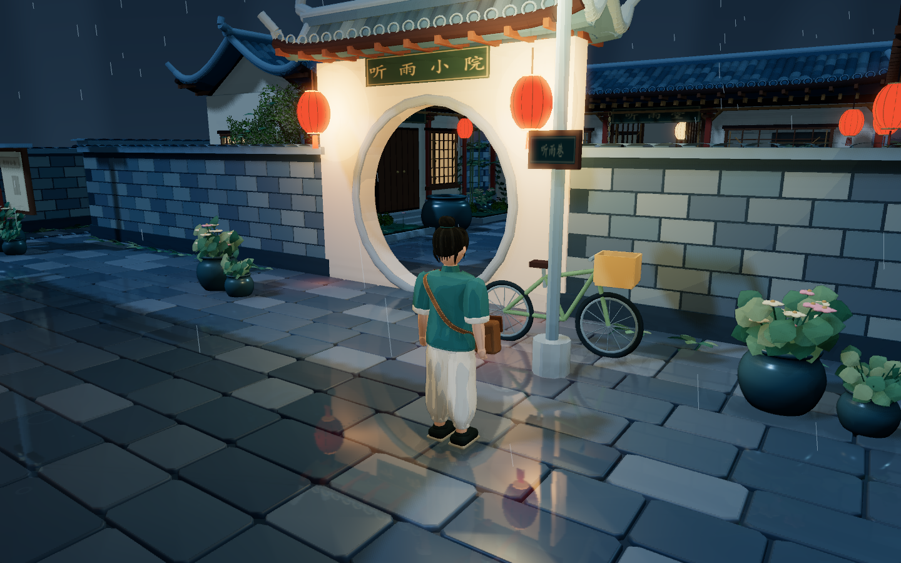
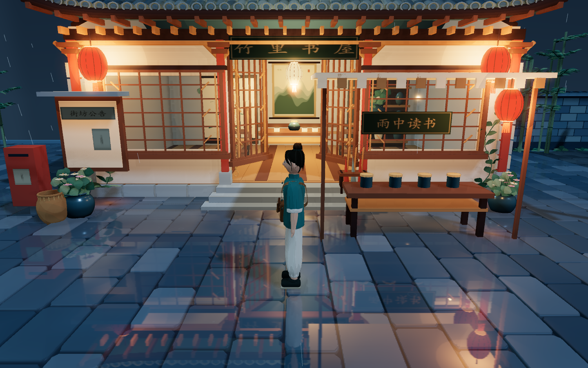
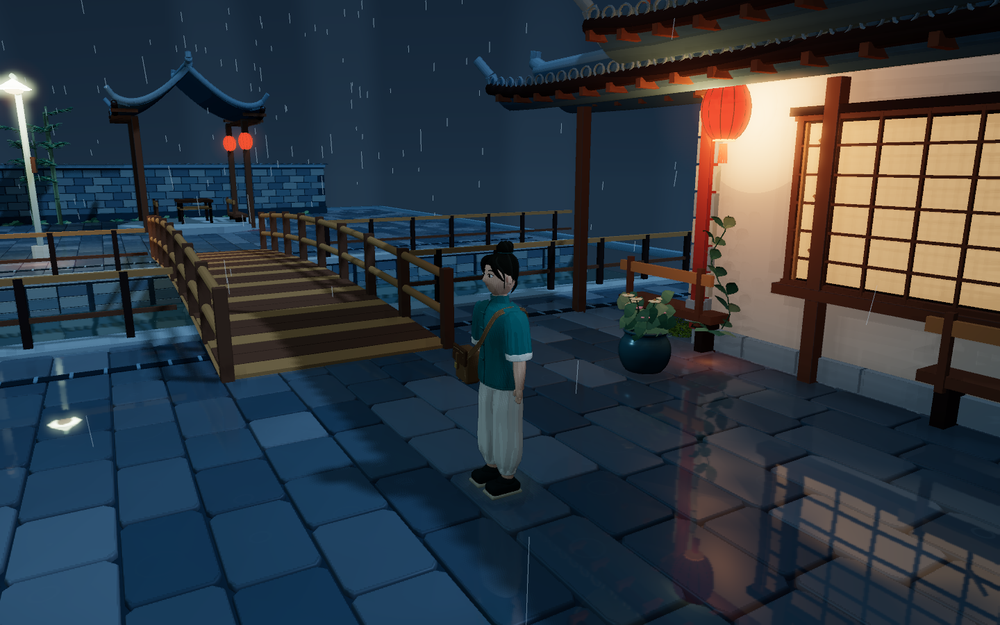

# 听雨小镇 v0.2.0 · 雨夜画风重整

更新日期：2026-10-21（Asia/Shanghai）。本轮按用户提供的初版提示词和 `assets/preview.png` 重整整个游戏的美术方向，保留第三人称自由漫游。

## 重新对齐的方向

此前日景版本的明亮全局光、大面积浅色铺装和稀疏分布削弱了初版的层次；高粗糙度表面与程序噪声也让材质显得灰、平。初版的质感来自紧凑的前中后景、冷暖局部照明、干净色块、清晰轮廓和湿地倒影。本轮围绕这些关系改动全图。

整张地图从约 180×180 米收拢为 **56×56 米方形街区**，面积约为前版的十分之一。10 栋建筑与两座桥连接小院、转角雨巷、茶铺、水街和柳岸；主环线和两条支路均双向可走。听雨堂、春和茶铺、一叶茶、竹里书屋可进入。

## 具体改动

| 范围 | 当前实现 |
| --- | --- |
| 全图配色 | 冷蓝夜色、灰青瓦、青砖与米色墙面，暖红灯笼和暖纸窗统一使用同一套色彩关系 |
| 光影 | 月色主光、冷色轮廓补光、局部暖色点光、接触阴影和克制的柔辉；控制灯笼自发光与灯筋亮度，保留红色灯罩 |
| 动画画风 | 建筑、人物和植物使用四级赛璐璐色阶；主构件合并细轮廓线，深度边界补充细线 |
| 湿润表面 | 青石控制粗糙度与小幅凹凸，断续积水反射叠在石面上；台阶保留冷色高光 |
| 河道 | 独立的较低水面、动态倒影、微波纹和雨滴圈；湿地与河道反射分别处理，捕获时相互隐藏以避免递归 |
| 雨景 | 2,400 条动态斜雨，按建筑屋顶和雨棚的投影计算落点，减少穿屋顶、穿室内的雨丝 |
| 生活细节 | 自行车、老邮筒、公告栏、年画、雨伞架、竹编篮、雨链、水缸、排水沟、空调外机、街灯、电线杆与下垂电线 |
| 室内 | 半开木格门、大面积清玻璃窗、茶桌、太师椅、茶具、条案、博古架、屏风与纸吊灯；移除重叠吊灯 |
| 空间 | 道路连续贴着建筑转折，空旷草地换成院落、铺装、街角小物与局部种植；房屋背面也补充窗、墙脚和木构细节 |
| 交互 | 第三人称行走、轻跑、镜头避障、地图、照片保存与三档画质保留；新增 H 隐藏界面，环境声改成雨声与滴水 |

## 渲染与性能策略

`night-lighting.ts` 保存灯的位置、灯晕和地面暖光，并选择靠近观察区域的 10 个点光源参与几何照明；点光源不额外生成阴影立方体。重复瓦片、石板、砖和构件仍按区域实例化。

`wet-surfaces.ts` 分别放置湿地与河道的反射面。镜头移动时按画质更新，静止时降低更新频率；窗口、投影或画质改变后重新捕获。高光捕获、模糊、接触阴影与合成在 `rendering.ts` 的线性空间中完成，最终统一色调映射和颜色输出，避免天空与反射被重复变换。

轻盈画质关闭后处理并降低反射分辨率/更新频率，仍保留夜色、暖灯、轮廓与湿润表面的基础表现。均衡使用 896×640 左右的反射纹理与四分之一分辨率柔辉；细致提高反射、阴影和屏幕采样质量。

## 验证

机器可读证据见 [verification-v0.2.0.json](verification-v0.2.0.json)。原始报告和额外图片位于 `test-results/`。

- 原版构建、五张原型图和八份初版文件的内容校验通过；`assets/preview.png` 保持原内容。
- TypeScript 与生产构建通过。
- 20 项功能检查通过：键鼠、失焦、暂停、隐藏界面、地图、拍照、复位、双向完整路线、支路、房屋/河岸/桥栏/边界/桌子碰撞、茶室台阶、镜头避障和斜向速度。
- 八组机位覆盖小院、人物正面、雨巷、河岸、石桥、竹影水街、茶室和柳岸；三档画质与窗口缩放未记录运行或 shader 错误。
- Chrome 155.0.8059.80 与 Edge 155.0.4283.62 的生产检查通过：真实行走、地图、音频、照片、三档画质、复位与窗口缩放；没有外部资源请求，生产页面不暴露开发诊断接口。
- 10 分钟跨区域稳定性测试通过（600.012 秒），无运行错误；预热后几何体和纹理增长均为 0。测试时几何体最多 192，纹理最多 53；最终地图箭头调整后另做功能与生产回归。
- 游玩包的 9 个文件逐字节对应当前构建；解压服务器、JS gzip 和重新构建后压缩页面缓存失效检查通过。

性能采样：本机 NVIDIA GeForce GT 730（ANGLE D3D11），Chrome、1440×900、像素比 1、均衡画质，雨巷固定视角 240 帧。平均约 26.90 ms（约 37 FPS），P95 约 50 ms；采样帧 342 次绘制、1,366,980 个三角形（含该帧的反射等通道）。固定机位数据不代表所有路线和设备。

## 直接运行

双击项目根目录的 [启动听雨小镇.cmd](../启动听雨小镇.cmd)，或运行 `python scripts/play.py`。已打开旧页面时，刷新网页载入当前构建。

游玩包：[tingyu-town-v0.2.0.zip](../release/tingyu-town-v0.2.0.zip)，大小 **1,849,537 字节**，9 个文件。解压后双击启动器；需要 Python 3 和支持 WebGL 2 的电脑浏览器。

SHA-256：`18bf6c320938c0f325256dc496681a89abc4a461b55889424115aaebb7e01639`。

## 实机画面

其他机位：[小院](../assets/night-courtyard.png)、[石桥](../assets/night-stone-bridge.png)、[茶室](../assets/night-tea-room.png)、[街区全景](../assets/night-overview.png)。

这是延续初版色彩和模型语言的可行走雨夜版本。角色和场景仍由代码生成；首期玩法仍是观景与自由行走，尚未包含 NPC 任务、战斗、存档或手机摇杆。初版观景和此前 0.1.0 文档保留为独立历史资料。
