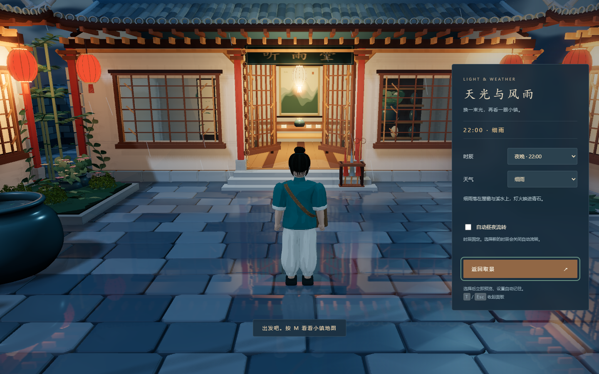
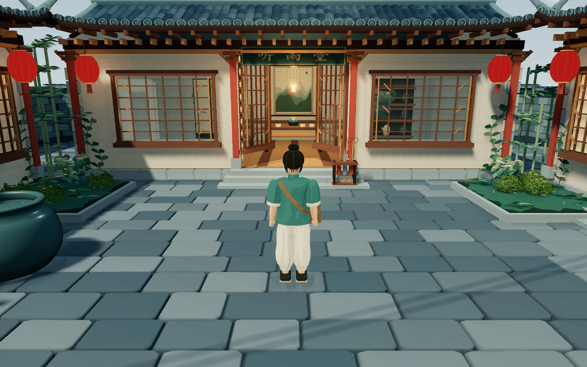
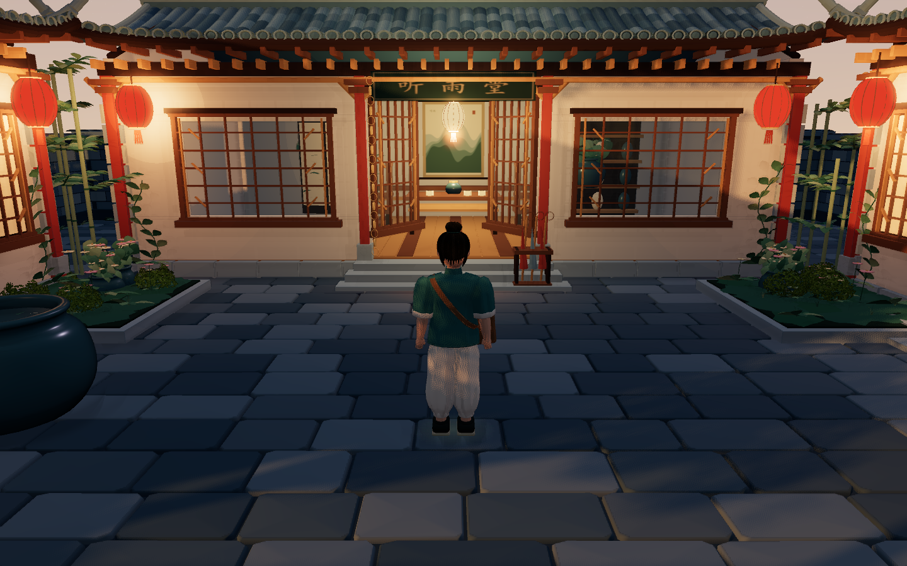

# 听雨小镇 v0.3.0 · 天气与时间

更新日期：2026-10-21（Asia/Shanghai）。在 0.2.0 的紧凑雨夜街区基础上，加入可手动组合的天气与时辰，以及可选的自动昼夜流转。默认仍为细雨夜晚。

## 操作

按 **T** 或点击右上角“景”，打开右侧“天光与风雨”面板。暂停菜单与拍照模式也有入口，打开时角色停止移动，环境变化可以直接在画面中预览。按 T、Esc 或“返回取景”收起，从拍照模式进入后会回到拍照。

| 时辰 | 画面变化 |
| --- | --- |
| 清晨 · 06:00 | 柔和晨光、偏暖的地平线、较低角度的光照 |
| 白天 · 12:00 | 蓝天与日光，室外灯火减弱，晴天地面收干 |
| 夕阳 · 18:00 | 低角度暖光、偏粉橙天空、长阴影，街灯逐渐显现 |
| 夜晚 · 22:00 | 保留原版冷蓝夜色与暖窗灯笼，晴夜有稀疏星点 |

| 天气 | 画面与声音变化 |
| --- | --- |
| 晴朗 | 少云，无雨；地面水光逐渐收起，雨声与滴水淡出 |
| 多云 | 天光柔和、云量增加，无雨；少量湿意保留 |
| 细雨 | 较稀疏雨丝、湿地倒影、雨滴圈和轻雨声 |
| 大雨 | 更密、更快、略长的斜雨，增加风感、水面涟漪和雨声 |

时辰与天气独立组合，共 16 种。选择后约数秒内平滑过渡，云、光、灯、地面和声音由同一份状态驱动。

勾选“自动昼夜流转”，漫游或拍照时约 8 分钟经过完整一天；暂停、地图、环境面板和隐藏网页时停止推进。手动选择任何时辰会关闭自动流转，方便固定拍照光线。浏览器保存所选时辰、天气和自动流转开关，刷新后恢复；声音仍需主动开启。存储不可用或内容无效时使用默认值。

## 实现

- `game/src/climate.ts`：统一的时刻/天气状态、关键时刻颜色插值、光照方向、灯火强度、持久化及自动时钟。
- `atmosphere.ts`：同一个天空着色器切换调色板、云量、日轮和星光，输出仍统一色调映射。
- `night-lighting.ts` 与 `world.ts`：白天降低室外点光、灯晕、纸窗自发光；室内保留柔和照明，避免茶室变黑。
- `rain.ts` 与 `wet-surfaces.ts`：复用现有几何、材质和反射目标，调整雨丝绘制数量、速度、斜度、雨滴圈及湿地反射。晴天地面提高粗糙度，河道保持反射。
- `audio.ts`：独立的雨声与风声增益，天气切换不重建音频上下文，晴天不再播放雨滴。
- `main.ts` / `game/index.html` / `style.css`：可直接预览画面的侧面板、暂停/拍照入口、键盘快捷键与设置同步；切换清除行走输入，避免按键卡住。

昼夜变化复用原有物件，不重新生成地图。人物薄衣褶使用柔和接触影并保留建筑投影，减少低角度光下的自阴影噪声。布料的细碎凹凸贴图也移除，服装以真实几何褶皱和干净色阶表现。

## 验证

- `npm.cmd run verify`：初版与原型校验、依赖加载、TypeScript 和生产构建通过。
- `npm.cmd test`：原有 20 项漫游、双向路线、碰撞、镜头、地图、拍照和隐藏界面检查通过。
- `npm.cmd run test:climate`：19 项专门检查与 16 种画面组合通过。检查日夜明暗差、夕阳暖色、雨量、灯火、雨声淡出、自动计时/暂停、手动覆盖、照片、设置恢复与无效数据；重复切换没有持续增加几何体和纹理数量。
- Chrome 155.0.8059.80 与 Edge 155.0.4283.62 的生产检查通过，覆盖天气/时间/自动开关、行走、地图、音频、照片、画质、复位和窗口缩放；无外部请求、运行时或 shader 错误。
- 10 分钟稳定性测试通过（600.017 秒）：开启自动流转、每分钟改变天气并跨七组机位运行，观测到完整四时辰与四天气，无运行错误；预热后几何体/纹理增长均为 0，分别最多 192/52。详细结果见 [verification-v0.3.0.json](verification-v0.3.0.json)。
- 游玩包：9 个文件逐字节对应构建，解压服务、gzip 和页面重建缓存检查通过。

原始报告和 16 张组合截图位于 `test-results/climate/`。当前功能在本机 GT 730、1440×900、像素比 1、均衡画质的默认雨夜雨巷视角采样，平均约 27.81 ms（约 36 FPS），P95 约 49.9 ms。天气变化与镜头位置会影响性能，慢设备可切换“轻盈”。

## 直接体验

双击 [启动听雨小镇.cmd](../启动听雨小镇.cmd)，或运行 `python scripts/play.py`。若旧服务窗口仍开着，先关闭后重新启动并刷新网页。

分发包：[tingyu-town-v0.3.0.zip](../release/tingyu-town-v0.3.0.zip)，1,854,814 字节，9 个文件。

SHA-256：`1c159d8f24314148dbe8590d39697e84f39f0c43c395c7e8b0a3e56463c506f3`。

本轮提供本地场景预设，不接入现实天气或真实地理时间。天气不会自动随机改变，只有可选的时刻流转；地图布局与第三人称玩法继续沿用紧凑街区版本。
