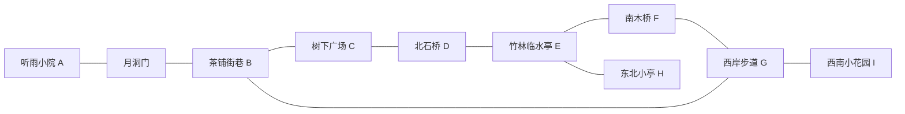

# 听雨小镇 · 地图与路线

依据：[图 2](../../yuanxingtu/image_2.png)。具体坐标保存于 [world-layout.json](world-layout.json)。坐标是可修改的灰盒设计草案，不是对原型图进行测绘后的精确结果。

## 方位与尺度

- 初始区域约 180×180 米，西岸住宅/茶铺，东岸竹林/观景步道。
- Y 向上；+X 向东，-Z 向北；地图中心为 `(0, 0, 0)` 的水平投影。
- 水面 Y=0，普通岸边道路初始 Y=1.2；建筑地坪以所在道路高度为基准。
- 主街净宽 4 米，院落路径 2.2–3 米，支路不低于 1.8 米。
- 河道初始宽度约 18 米，沿中部弯曲；两座桥有明确的两岸引道。
- 环境边界使用坡地、密林、墙体和栏杆与不可通行碰撞体共同说明。

## 地点定义

| ID | 地点 | 中心 X/Z（米） | 功能 |
| --- | --- | --- | --- |
| A | 听雨小院 | -52 / -56 | 出生点、茶室、教学操作空间 |
| A_GATE | 小院南门 | -52 / -40 | 连接院内与街巷的月洞门 |
| B | 茶铺街巷 | -50 / -20 | 连接小院、广场和西岸返程 |
| C | 树下广场 | -24 / -19 | 第一处开阔视野，能看到石桥 |
| D | 北石桥 | 11 / -38 | 跨河主通道、观景点 |
| E | 竹林临水亭 | 37 / -4 | 东岸中段、休息和水景 |
| F | 南木桥 | 11 / 44 | 返回西岸的第二通道 |
| G | 西岸步道 | -22 / 44 | 沿岸返程，连接南段街巷 |
| H | 东北小亭 | 49 / -54 | 可选的短支路终点 |
| I | 西南小花园 | -65 / 48 | 可选的短支路终点 |

D/F 的桥头节点另行定义，桥面高度根据灰盒坡度调整，不直接使用表中的水平中心作为碰撞几何。

## 主环线

路线全部双向。图 2 的箭头只作构图提示，游戏没有单向行走限制。C 广场明确成为 B→D 的必经区域；主环不依赖穿过民居或跨越河水。A 是连接在主环上的起点支路。

完整行走设计：A→A_GATE→B→C→D_WEST→D→D_EAST→E→F_EAST→F→F_WEST→G→B_SOUTH→B→A_GATE→A。E→H、G→I 为观景支路。

## 建筑和地面约束

第一版规划 14 栋建筑体量（含小院主厅与两侧附房），另有院门、回廊、2 处亭和2座桥。具体摆放以道路净宽和图 1 的视线为优先，避免只按屋顶俯视图拼接后堵住路口。

- 主厅门净宽不低于 1.8 米；可通行月洞门在人物肩部高度处有足够宽度。
- 普通台阶单级 0.12–0.18 米；可行走桥面使用连续坡面碰撞，视觉上可保留台阶。
- 人物碰撞体拟用半径约 0.28 米、总高约 1.65 米的胶囊；角色网格与碰撞体独立。
- 石桥拱起高度初设约 2 米，灰盒测量坡度并与控制器最大攀爬角统一。
- 小院到主街、桥头到岸道不留肉眼难察觉的碰撞缝隙。
- 花盆、桌椅、树干有简化实体；草、花瓣、低矮小叶片不参与阻挡。
- 水面为首版不可游泳区域；岸边台阶可以下行到安全观景平台，边缘使用与视觉匹配的限制。
- 隐藏阻挡须与墙、护栏或植被边缘对齐，不在空旷道路中设无提示障碍。

## 灰盒必须验证

1. 从 A 可双向走完主环并返回，两个支路可原路退出。
2. C 广场到北桥有明确视线和连续路面，房屋与树冠不挡住主要方向。
3. 两桥可上可下，斜向移动不卡台阶；掉帧后不穿过栏杆或沉入地面。
4. 穿过月洞门、进入茶室和走出回廊时，身体与镜头都不卡墙。
5. 河岸与地图外缘无法跌落；复位功能始终能回到合法位置。
6. 在普通行走速度下记录实际游览用时，再调整地图密度。目标是数分钟内能看完一圈且途中持续出现值得停留的景观。

图中的船只、远山与远岸民居作为环境景物，首版不承担乘船或远距离探索功能。
